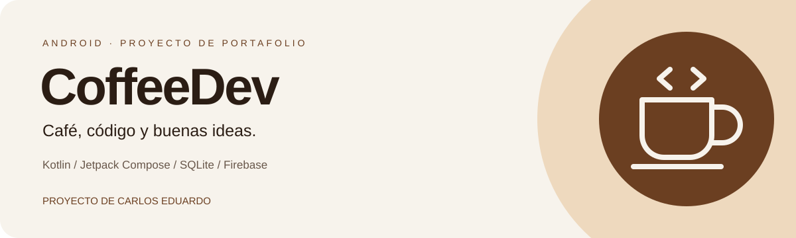
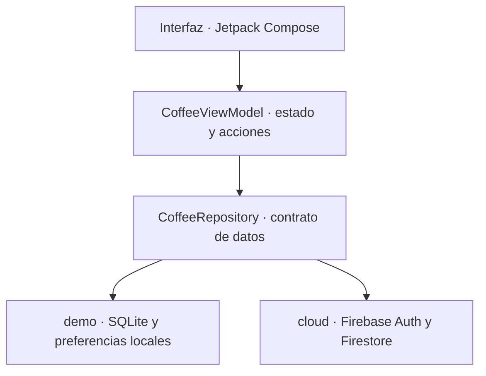

  <a href="README.md" lang="pt-BR">Português</a> · <strong>Español</strong>

  

  <strong>Una experiencia de cafetería desarrollada como aplicación nativa para Android.</strong> 
  Proyecto de autoría de <a href="https://www.linkedin.com/in/carlos-eduardo-a8bb50268/">Carlos Eduardo</a> · versión 1.2.0

  <a href="#experiencia-de-la-aplicación">Experiencia</a> ·
  <a href="#tecnologías-utilizadas">Tecnologías</a> ·
  <a href="#arquitectura">Arquitectura</a> ·
  <a href="#pruebas-y-validación">Pruebas</a> ·
  <a href="#auditoría-y-documentación">Auditoría</a> ·
  <a href="#autoría-y-apoyo-de-ia">Autoría</a>

## Acerca de CoffeeDev

CoffeeDev es un proyecto personal de portafolio que reúne desarrollo móvil, identidad visual, persistencia de datos y control de acceso en una cafetería ficticia. La propuesta es transformar la experiencia de elegir un café en un flujo completo: explorar la carta, personalizar un pedido, seguir sus etapas y administrar el servicio.

La interfaz combina tonos crema, marrón café y caramelo con fotografías conceptuales de productos, temas claro y oscuro y contenido en tres idiomas. El proyecto también documenta las decisiones técnicas, las pruebas ejecutadas, el origen de las imágenes y la revisión de privacidad y accesibilidad.

**Autor y responsable del proyecto: Carlos Eduardo.** CoffeeDev es una demostración educativa: los productos, precios y pedidos representan una simulación, sin cobros ni actividad comercial de cafetería.

## Experiencia de la aplicación

| Área | Funcionalidades |
|---|---|
| Carta | Diez productos, categorías, búsqueda, detalles, disponibilidad y favoritos |
| Cafés y acompañamientos | Cappuccino, espresso, latte, cold brew, mocha, cookie, croissant, pão na chapa (pan tostado a la plancha), pão de queijo (pan de queso brasileño) y brownie |
| Carrito | Cantidades por producto, observaciones opcionales e importes calculados en centavos |
| Pedidos | Historial y etapas: recibido, en preparación, listo y completado |
| Acceso | Inicio de sesión, solicitud de registro y aprobación manual por el propietario |
| Administración | Aprobar/suspender cuentas, modificar precios/disponibilidad y avanzar el estado de los pedidos |
| Personalización | Tema claro, oscuro o del sistema; portugués, inglés y español |
| Datos locales | Persistencia de sesión, pedidos, carrito y preferencias en el dispositivo |
| Privacidad | Políticas disponibles antes de iniciar sesión, exportación JSON y eliminación de datos locales |
| Accesibilidad | Campos etiquetados, controles descritos, contraste revisado y cuadrícula adaptada a fuentes ampliadas |

<table>
  <tr>
    <td align="center"> <strong>Cappuccino</strong></td>
    <td align="center"> <strong>Espresso</strong></td>
    <td align="center"> <strong>Croissant</strong></td>
  </tr>
</table>

Imágenes conceptuales generadas con IA para el proyecto. No representan productos de una cafetería en funcionamiento.

## Tecnologías utilizadas

| Tecnología | Función en el proyecto |
|---|---|
| **Kotlin 2.1.20** | Lenguaje principal de la aplicación Android |
| **Jetpack Compose** | Interfaz declarativa y composición de las pantallas |
| **Material 3** | Componentes, estados visuales, temas y comportamiento de los controles |
| **AndroidX Activity y Lifecycle** | Integración con Android, ViewModel y recolección de estado respetando el ciclo de vida |
| **Coroutines y StateFlow** | Operaciones asíncronas y propagación del estado de los datos a la interfaz |
| **SQLite / SQLiteOpenHelper** | Base de datos de la demostración local, con escrituras transaccionales |
| **SharedPreferences** | Idioma, tema, favoritos, carrito e identificadores locales por usuario |
| **Firebase Authentication** | Autenticación mediante correo electrónico y contraseña en la variante conectada opcional |
| **Cloud Firestore** | Accesos, catálogo y pedidos de la variante conectada; reglas de autorización en la base de datos |
| **PBKDF2-HMAC-SHA256** | Derivación de contraseñas de las cuentas locales de prueba, con salt aleatorio |
| **Gradle 8.11.1 / Android Gradle Plugin 8.9.2** | Compilación Android y separación de las variantes `demo` y `cloud` |
| **JUnit 4 / Robolectric 4.14.1** | Pruebas de reglas locales, recursos Android, persistencia, privacidad y contraste |
| **Android Lint** | Análisis estático de los dos modos de la aplicación |
| **Node.js / Firebase Admin SDK** | Herramientas administrativas auxiliares y aprovisionamiento del propietario cloud |
| **Firebase Emulator Suite** | Pruebas de las reglas Auth/Firestore en un entorno ficticio |
| **Python 3** | Verificaciones reproducibles de archivos, traducciones, colores, imágenes y documentación |
| **GitHub Actions** | Workflow versionado de pruebas, verificaciones y generación del APK de demostración |

La configuración Android utiliza `minSdk 26` (Android 8.0), `compileSdk 35` y `targetSdk 35` (Android 15), con bytecode de destino Java 17. La suite actual de emuladores Firebase utiliza JDK 21. El entorno recomendado para las herramientas Node es Node.js 22 LTS.

Las fuentes **Sora** e **Inter** se incluyen en la aplicación bajo la SIL Open Font License. Las imágenes de los productos son locales, en formato **WebP**, y el icono de la aplicación dispone de capas adaptables, variante redonda y recurso monocromático para las versiones compatibles.

Las versiones detalladas y los hashes de los artefactos se encuentran en los [inventarios de dependencias](docs/auditoria/DEPENDENCIAS.md).

## Arquitectura

La aplicación adopta una organización **MVVM con abstracción de repositorio**. La interfaz observa los estados del ViewModel, mientras que la implementación de datos se selecciona durante la compilación.

| Parte | Responsabilidad |
|---|---|
| `MainActivity` | Iniciar la aplicación y alojar la composición de la interfaz |
| `ui/CoffeeApp.kt` | Pantallas, navegación por estado e interacción con la carta, los pedidos y la administración |
| `ui/CoffeeViewModel.kt` | Estado de presentación, carrito, preferencias y ejecución de las acciones del usuario |
| `ui/Theme.kt`, `Strings.kt` y `CoffeeArt.kt` | Identidad visual, traducciones y presentación de las imágenes |
| `ui/LegalCenter.kt` | Políticas, licencias, borradores de solicitudes y acciones sobre los datos locales |
| `data/Models.kt` | Modelos, catálogo, validación de totales y contrato `CoffeeRepository` |
| `src/demo` | Repositorio local, base de datos SQLite, migración y derivación de contraseñas |
| `src/cloud` | Repositorio conectado y listeners de Firebase |
| `backend` | Scripts administrativos y pruebas de dominio/reglas; no es un servidor web de la aplicación |
| `docs` | Arquitectura, validación, auditoría, políticas y evidencias |

La separación es lógica, por paquetes y conjuntos de fuentes, dentro del módulo Android `:app`. Las herramientas Node se encuentran en una carpeta propia. Esta estructura permite estudiar dos estrategias de persistencia sin mezclar la implementación local con la conectada.

### Dos variantes de datos

| Aspecto | `demo` — APK disponible | `cloud` — integración opcional |
|---|---|---|
| Aplicación | `dev.coffeedev.demo` | `dev.coffeedev` |
| Base de datos | SQLite privado de Android | Cloud Firestore |
| Autenticación | Cuentas locales de prueba | Firebase Authentication |
| Red | El APK local no solicita permiso de internet | Acceso a la red para los servicios Firebase |
| Imágenes y fuentes | Incluidas en la aplicación | También incluidas en la aplicación |
| Administración | Propietario de demostración público en esta instalación | Propietario único aprovisionado administrativamente |
| Estado | Demostración con datos ficticios | Código integrado; la activación requiere configuración y revisión del despliegue |

SQLite guarda las cuentas, la sesión, el catálogo editado y los pedidos mediante transacciones. Las preferencias almacenan el idioma/tema y los datos del carrito/favoritos asociados al usuario. La migración importa el formato anterior y elimina la copia antigua después de guardar los datos.

En Firestore, las colecciones/documentos principales son `system/owner`, `access/{uid}`, `catalog/menu` y `orders/{id}`. El catálogo reúne los diez productos en un documento para permitir la validación de un pedido completo dentro de los límites de lectura de las reglas.

### Reglas y decisiones de implementación

- Los importes monetarios son enteros en centavos; el formato de visualización se adapta al idioma y mantiene BRL.
- Las cantidades se validan entre 1 y 10 por producto, con comprobación de disponibilidad.
- Se conserva un identificador de solicitud en los reintentos de envío para evitar pedidos duplicados.
- El registro no concede acceso automáticamente: las cuentas esperan la aprobación del propietario.
- Las cuentas suspendidas dejan de recibir el contenido de negocio, y las reglas cloud comprueban los permisos independientemente de la interfaz.
- Las contraseñas locales utilizan PBKDF2 con 210 mil iteraciones y salt aleatorio de 32 bytes; los hashes antiguos se migran tras un inicio de sesión válido.
- La exportación local consulta únicamente la cuenta autenticada y sus pedidos, sin incluir contraseñas, salts ni hashes.
- La eliminación de una cuenta de visitante borra la cuenta, los pedidos y las preferencias de ese usuario; el propietario de demostración puede limpiar toda la instalación.

Consulta el [documento de arquitectura](docs/ARQUITETURA.md) para obtener una descripción completa del almacenamiento, los pedidos y la identidad visual.

## Pruebas y validación

El proyecto reúne pruebas automatizadas del código y pruebas de uso de la aplicación Android comunicadas por el autor. Las dos fuentes de evidencia se identifican a continuación.

### Entorno Android

| Entorno | Tipo de verificación | Registro |
|---|---|---|
| **Android 15 — API 35** | Prueba de uso de la aplicación comunicada por Carlos Eduardo | Declaración del autor; también corresponde al `compileSdk` y `targetSdk` del proyecto |
| **Android 16 — API 36** | Prueba de uso de la aplicación comunicada por Carlos Eduardo | Declaración del autor; no es la versión del SDK utilizada para compilar este APK |
| **Android 14 — API 34** | Recursos Android y persistencia con Robolectric | Configuración de las pruebas versionada en `app/src/testDemo` |
| **JVM / JUnit** | Catálogo, totales, traducciones y pares de contraste | Pruebas compartidas en `app/src/test` |
| **Auth/Firestore locales** | Reglas y flujos administrativos en emuladores oficiales | Proyecto ficticio `demo-coffeedev`, sin una instancia real del usuario |

Las declaraciones de uso en Android 15 y 16 no sustituyen una batería de pruebas instrumentadas en esos sistemas. No se adjuntaron el modelo del dispositivo, registros ni un protocolo completo de esas pruebas manuales. Las pruebas específicas de TalkBack, Switch Access y navegación por teclado siguen registradas como tareas pendientes de accesibilidad.

### Resultados registrados para la versión 1.2.0

| Verificación | Resultado |
|---|---|
| Pruebas Android de la variante local | **19 aprobadas**, sin fallos ni errores |
| Pruebas compartidas de la variante cloud | **7 aprobadas**, sin fallos ni errores |
| Pruebas Node de dominio | **7 aprobadas** |
| Pruebas de reglas Auth/Firestore | **16 aprobadas** |
| Android Lint local | **0 errores**, 17 advertencias |
| Android Lint cloud | **0 errores**, 11 advertencias |
| Compilación limpia y firma del APK | Completadas; firma compatible con la versión 1.1 |
| Integridad de los archivos | APK, imágenes y paquete verificados |

Las pruebas cubren totales, cantidades, falta de disponibilidad, traducciones, contraste declarado, iconos adaptables, persistencia al volver a abrir, aprobación/suspensión, pedidos, exportación individual, eliminación y migración de datos/contraseñas.

El [registro de validación](docs/VALIDACAO.md) y las [evidencias estructuradas](docs/auditoria/testes-android.json) detallan el alcance de los resultados. El workflow en [`.github/workflows/android.yml`](.github/workflows/android.yml) automatiza las verificaciones y la generación del APK; el estado de cada ejecución se encuentra en la pestaña **Actions** del repositorio.

## Auditoría y documentación

La revisión técnica abarca privacidad, derechos de los titulares de datos, accesibilidad, imágenes, licencias, identificación del autor y riesgos residuales.

**Empieza por el [informe de auditoría](docs/auditoria/RELATORIO.md)**. El proyecto también incluye una versión para leer en el navegador: [Auditoria-CoffeeDev.html](docs/auditoria/Auditoria-CoffeeDev.html).

| Documento | Contenido |
|---|---|
| [Informe técnico](docs/auditoria/RELATORIO.md) | Hallazgos, correcciones, riesgos residuales y condiciones previas al uso real |
| [Inventario de datos](docs/auditoria/INVENTARIO-DADOS.md) | Datos, finalidad, almacenamiento, acceso y eliminación |
| [Accesibilidad](docs/auditoria/ACESSIBILIDADE.md) | Medidas implementadas y pruebas manuales necesarias |
| [Contraste](docs/auditoria/CONTRASTE.md) | Combinaciones de colores, relaciones calculadas y umbrales adoptados |
| [Imágenes y derechos](docs/auditoria/IMAGENS.md) | Origen, revisión visual y límites de los derechos de uso |
| [Prompts de las imágenes](docs/IMAGENS.md) | Descripciones utilizadas para generar los diez productos |
| [Dependencias](docs/auditoria/DEPENDENCIAS.md) | Versiones, inventarios, alertas y alcance de los análisis |
| [Gestión LGPD](docs/auditoria/GESTAO-LGPD.md) | Orientaciones para atender solicitudes y registrarlas de forma privada |
| [Políticas PT/EN/ES](docs/politicas) | Privacidad, términos, almacenamiento, accesibilidad y créditos |
| [Fuentes consultadas](docs/auditoria/FONTES.md) | Referencias oficiales utilizadas en la revisión |
| [Seguridad](SECURITY.md) | Contexto de demostración y canal para comunicaciones privadas |
| [Copyright](COPYRIGHT.md) y [avisos de terceros](THIRD_PARTY_NOTICES.md) | Autoría propia, componentes, fuentes y licencias |

Los documentos enlazados conservan su idioma original; las políticas indicadas como PT/EN/ES incluyen sus respectivas versiones en esos idiomas.

El área pública de la aplicación permite leer las políticas antes de iniciar sesión. El formulario prepara un borrador en memoria, con copia explícita y contacto privado por LinkedIn; no envía datos automáticamente. Como no se identificaron cookies ni rastreadores opcionales en el APK nativo local, el aviso explica el almacenamiento efectivo en el dispositivo.

La revisión es técnica y asistida: no representa una certificación LGPD/WCAG, un dictamen jurídico, un registro de marca ni una garantía de ausencia de fallos. El último análisis registró siete alertas residuales en el árbol de dependencias Node de desarrollo/pruebas; el análisis de dependencias Node de producción no detectó alertas. Estos resultados no equivalen a un análisis exhaustivo del APK. Las condiciones para un despliegue cloud con datos reales siguen documentadas.

## Autoría y apoyo de IA

**CoffeeDev es un proyecto de autoría de Carlos Eduardo**, concebido y dirigido como parte de su portafolio de desarrollo de software. La concepción del producto, la elección de la experiencia y la identidad visual y las decisiones sobre la evolución del proyecto se presentan bajo su autoría y responsabilidad.

Se utilizaron herramientas de inteligencia artificial como apoyo en el proceso de desarrollo, incluida la **generación de imágenes conceptuales**, la resolución de dudas de programación, las sugerencias de implementación, la revisión y corrección de código y la organización de la documentación. La declaración de autoría no significa que cada línea se haya escrito manualmente sin herramientas de asistencia.

Las fuentes, bibliotecas e iconos de terceros conservan sus respectivos titulares y licencias. Las imágenes generadas con IA tienen su origen documentado, sin promesas de exclusividad de derechos de autor ni de registro de la marca CoffeeDev.

## Aplicación e información del proyecto

El [APK de demostración de la versión 1.2.0](downloads/CoffeeDev-1.2.0-demo.apk) se incluye en el repositorio, con [SHA-256](downloads/SHA256SUMS.txt) para comprobar su integridad. Utiliza la base de datos local y está destinado a pruebas con datos ficticios. El administrador de demostración es público; esta instalación no debe almacenar datos reales ni confidenciales.

No se incluyen claves privadas de firma. Las nuevas compilaciones debug utilizan la clave local predeterminada del Android Gradle Plugin y pueden tener una firma diferente de la del APK distribuido.

Las credenciales de prueba y la información específica de la demostración se encuentran en la [guía de instalación](docs/INSTALACAO.md). Los detalles de la integración opcional están en la [guía Firebase](docs/ATIVAR-FIREBASE.md).

**Carlos Eduardo** · [GitHub](https://github.com/C4rlossz) · [LinkedIn](https://www.linkedin.com/in/carlos-eduardo-a8bb50268/)

Proyecto personal de portafolio. Código propio con derechos reservados en la medida de la legislación aplicable; los componentes de terceros siguen sus respectivas licencias. Consulta [COPYRIGHT.md](COPYRIGHT.md).
