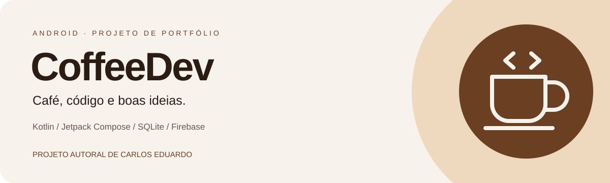
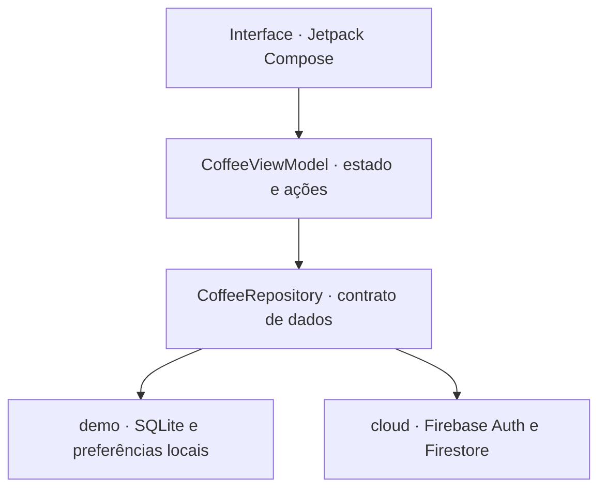

  <strong>Português</strong> · <a href="README.es.md" lang="es">Español</a>

  

  <strong>Uma experiência de cafeteria construída como aplicativo Android nativo.</strong> 
  Projeto autoral de <a href="https://www.linkedin.com/in/carlos-eduardo-a8bb50268/">Carlos Eduardo</a> · versão 1.2.0

  <a href="#experiência-do-aplicativo">Experiência</a> ·
  <a href="#tecnologias-utilizadas">Tecnologias</a> ·
  <a href="#arquitetura">Arquitetura</a> ·
  <a href="#testes-e-validação">Testes</a> ·
  <a href="#auditoria-e-documentação">Auditoria</a> ·
  <a href="#autoria-e-apoio-de-ia">Autoria</a>

## Sobre o CoffeeDev

O CoffeeDev é um projeto pessoal de portfólio que reúne desenvolvimento mobile, identidade visual, persistência de dados e controle de acesso em uma cafeteria fictícia. A proposta é transformar a experiência de escolher um café em um fluxo completo: explorar o cardápio, personalizar um pedido, acompanhar suas etapas e administrar o atendimento.

A interface combina creme, marrom café e caramelo com fotografias conceituais de produtos, temas claro e escuro e conteúdo em três idiomas. O projeto também documenta as decisões técnicas, os testes executados, a origem das imagens e a revisão de privacidade e acessibilidade.

**Autor e responsável pelo projeto: Carlos Eduardo.** CoffeeDev é uma demonstração educacional: os produtos, preços e pedidos representam uma simulação, sem cobrança ou operação comercial de cafeteria.

## Experiência do aplicativo

| Área | Funcionalidades |
|---|---|
| Cardápio | Dez produtos, categorias, pesquisa, detalhes, disponibilidade e favoritos |
| Cafés e acompanhamentos | Cappuccino, espresso, latte, cold brew, mocha, cookie, croissant, pão na chapa, pão de queijo e brownie |
| Carrinho | Quantidades por produto, observações opcionais e valores calculados em centavos |
| Pedidos | Histórico e etapas: recebido, em preparo, pronto e concluído |
| Acesso | Login, solicitação de cadastro e aprovação manual pelo proprietário |
| Administração | Aprovar/suspender contas, alterar preços/disponibilidade e avançar pedidos |
| Personalização | Tema claro, escuro ou do sistema; português, inglês e espanhol |
| Dados locais | Persistência de sessão, pedidos, carrinho e preferências no aparelho |
| Privacidade | Políticas disponíveis antes do login, exportação JSON e exclusão de dados locais |
| Acessibilidade | Campos rotulados, controles descritos, contraste revisado e grade adaptada a fontes ampliadas |

<table>
  <tr>
    <td align="center"> <strong>Cappuccino</strong></td>
    <td align="center"> <strong>Espresso</strong></td>
    <td align="center"> <strong>Croissant</strong></td>
  </tr>
</table>

Imagens conceituais geradas por IA para o projeto. Não representam produtos de uma cafeteria em operação.

## Tecnologias utilizadas

| Tecnologia | Papel no projeto |
|---|---|
| **Kotlin 2.1.20** | Linguagem principal do aplicativo Android |
| **Jetpack Compose** | Interface declarativa e composição das telas |
| **Material 3** | Componentes, estados visuais, temas e comportamento de controles |
| **AndroidX Activity e Lifecycle** | Integração Android, ViewModel e coleta de estado respeitando o ciclo de vida |
| **Coroutines e StateFlow** | Operações assíncronas e propagação do estado dos dados à interface |
| **SQLite / SQLiteOpenHelper** | Banco da demonstração local, com gravações transacionais |
| **SharedPreferences** | Idioma, tema, favoritos, carrinho e identificadores locais por usuário |
| **Firebase Authentication** | Autenticação por e-mail/senha na variante conectada opcional |
| **Cloud Firestore** | Acessos, catálogo e pedidos da variante conectada; regras de autorização no banco |
| **PBKDF2-HMAC-SHA256** | Derivação de senhas das contas locais de teste, com salt aleatório |
| **Gradle 8.11.1 / Android Gradle Plugin 8.9.2** | Build Android e separação das variantes `demo` e `cloud` |
| **JUnit 4 / Robolectric 4.14.1** | Testes de regras locais, recursos Android, persistência, privacidade e contraste |
| **Android Lint** | Análise estática dos dois modos do aplicativo |
| **Node.js / Firebase Admin SDK** | Ferramentas administrativas auxiliares e provisionamento do proprietário cloud |
| **Firebase Emulator Suite** | Testes das regras Auth/Firestore em ambiente fictício |
| **Python 3** | Verificações reproduzíveis de arquivos, traduções, cores, imagens e documentação |
| **GitHub Actions** | Workflow versionado de testes, verificações e geração do APK demonstrativo |

A configuração Android utiliza `minSdk 26` (Android 8.0), `compileSdk 35` e `targetSdk 35` (Android 15), com alvo de bytecode Java 17. A suíte atual dos emuladores Firebase utiliza JDK 21. O ambiente recomendado para as ferramentas Node é Node.js 22 LTS.

As fontes **Sora** e **Inter** são incorporadas ao aplicativo sob SIL Open Font License. As imagens dos produtos são locais, em **WebP**, e o ícone do aplicativo possui camadas adaptáveis, variante redonda e recurso monocromático para versões compatíveis.

Versões detalhadas e hashes dos artefatos estão nos [inventários de dependências](docs/auditoria/DEPENDENCIAS.md).

## Arquitetura

O aplicativo adota uma organização **MVVM com abstração de repositório**. A interface observa estados do ViewModel, enquanto a implementação de dados é selecionada no build.

| Parte | Responsabilidade |
|---|---|
| `MainActivity` | Iniciar o aplicativo e hospedar a composição da interface |
| `ui/CoffeeApp.kt` | Telas, navegação por estado, interação com cardápio, pedidos e administração |
| `ui/CoffeeViewModel.kt` | Estado de apresentação, carrinho, preferências e execução das ações do usuário |
| `ui/Theme.kt`, `Strings.kt` e `CoffeeArt.kt` | Identidade visual, traduções e apresentação das imagens |
| `ui/LegalCenter.kt` | Políticas, licenças, rascunhos de solicitações e ações de dados locais |
| `data/Models.kt` | Modelos, catálogo, validação de totais e contrato `CoffeeRepository` |
| `src/demo` | Repositório local, banco SQLite, migração e derivação de senhas |
| `src/cloud` | Repositório conectado e listeners Firebase |
| `backend` | Scripts administrativos e testes de domínio/regras; não é um servidor web do aplicativo |
| `docs` | Arquitetura, validação, auditoria, políticas e evidências |

A separação é lógica, por pacotes e conjuntos de fontes, dentro do módulo Android `:app`. As ferramentas Node ficam em uma pasta própria. Essa estrutura permite estudar duas estratégias de persistência sem misturar a implementação local com a conectada.

### Duas variantes de dados

| Aspecto | `demo` — APK disponibilizado | `cloud` — integração opcional |
|---|---|---|
| Aplicativo | `dev.coffeedev.demo` | `dev.coffeedev` |
| Banco | SQLite privado do Android | Cloud Firestore |
| Autenticação | Contas locais de teste | Firebase Authentication |
| Rede | O APK local não solicita permissão de internet | Acesso à rede para os serviços Firebase |
| Imagens e fontes | Incorporadas no aplicativo | Também incorporadas no aplicativo |
| Administração | Proprietário demonstrativo público nesta instalação | Proprietário único provisionado administrativamente |
| Situação | Demonstração com dados fictícios | Código integrado; ativação exige configuração e revisão da implantação |

O SQLite grava contas, sessão, catálogo editado e pedidos em transações. As preferências guardam idioma/tema e dados de carrinho/favoritos associados ao usuário. A migração importa o formato anterior e remove a cópia antiga depois da gravação.

No Firestore, as coleções/documentos centrais são `system/owner`, `access/{uid}`, `catalog/menu` e `orders/{id}`. O catálogo reúne os dez produtos em um documento para permitir a validação de um pedido completo dentro dos limites de leitura das regras.

### Regras e decisões de implementação

- Valores monetários são inteiros em centavos; o formato de exibição acompanha o idioma e mantém BRL.
- As quantidades são validadas entre 1 e 10 por produto, com verificação de disponibilidade.
- Um identificador de solicitação é preservado em tentativas de envio para evitar pedidos duplicados.
- Cadastro não concede acesso automaticamente: as contas aguardam a aprovação do proprietário.
- Contas suspensas deixam de receber o conteúdo de negócio, e as regras cloud verificam permissões independentemente da interface.
- Senhas locais usam PBKDF2 com 210 mil iterações e salt aleatório de 32 bytes; hashes antigos são migrados após login válido.
- A exportação local consulta apenas a conta autenticada e seus pedidos, sem incluir senhas, salts ou hashes.
- A exclusão de visitante remove conta, pedidos e preferências daquele usuário; o proprietário demonstrativo pode limpar a instalação inteira.

Leia o [documento de arquitetura](docs/ARQUITETURA.md) para a descrição completa do armazenamento, dos pedidos e da identidade visual.

## Testes e validação

O projeto reúne testes automatizados do código e testes de uso do aplicativo Android relatados pelo autor. As duas fontes de evidência são identificadas abaixo.

### Ambiente Android

| Ambiente | Tipo de verificação | Registro |
|---|---|---|
| **Android 15 — API 35** | Teste de uso do aplicativo informado por Carlos Eduardo | Relato do autor; também corresponde ao `compileSdk` e `targetSdk` do projeto |
| **Android 16 — API 36** | Teste de uso do aplicativo informado por Carlos Eduardo | Relato do autor; não é a versão de SDK usada para compilar este APK |
| **Android 14 — API 34** | Recursos Android e persistência com Robolectric | Configuração dos testes versionada em `app/src/testDemo` |
| **JVM / JUnit** | Catálogo, totais, traduções e pares de contraste | Testes compartilhados em `app/src/test` |
| **Auth/Firestore locais** | Regras e fluxos administrativos em emuladores oficiais | Projeto fictício `demo-coffeedev`, sem instância real do usuário |

Os relatos de uso em Android 15 e 16 não substituem uma bateria instrumentada nesses sistemas. Não foram anexados modelo do aparelho, logs ou um protocolo completo desses testes manuais. Testes específicos de TalkBack, Switch Access e navegação por teclado continuam listados como pendências de acessibilidade.

### Resultados registrados para a versão 1.2.0

| Verificação | Resultado |
|---|---|
| Testes Android da variante local | **19 aprovados**, sem falhas ou erros |
| Testes compartilhados da variante cloud | **7 aprovados**, sem falhas ou erros |
| Testes Node de domínio | **7 aprovados** |
| Testes de regras Auth/Firestore | **16 aprovados** |
| Android Lint local | **0 erros**, 17 avisos |
| Android Lint cloud | **0 erros**, 11 avisos |
| Build limpo e assinatura do APK | Concluídos; assinatura compatível com a versão 1.1 |
| Integridade dos arquivos | APK, imagens e pacote verificados |

Os testes cobrem totais, quantidades, indisponibilidade, traduções, contraste declarado, ícones adaptáveis, persistência após reabrir, aprovação/suspensão, pedidos, exportação individual, exclusão e migração de dados/senhas.

O [registro de validação](docs/VALIDACAO.md) e as [evidências estruturadas](docs/auditoria/testes-android.json) detalham o alcance dos resultados. O workflow em [`.github/workflows/android.yml`](.github/workflows/android.yml) automatiza verificações e geração do APK; o estado de cada execução fica na aba **Actions** do repositório.

## Auditoria e documentação

A revisão técnica reúne privacidade, direitos de titulares, acessibilidade, imagens, licenças, identificação do autor e riscos residuais.

**Comece pelo [relatório de auditoria](docs/auditoria/RELATORIO.md)**. Uma versão de leitura em navegador também acompanha o projeto: [Auditoria-CoffeeDev.html](docs/auditoria/Auditoria-CoffeeDev.html).

| Documento | O que você encontra |
|---|---|
| [Relatório técnico](docs/auditoria/RELATORIO.md) | Achados, correções, riscos residuais e condições antes de uso real |
| [Inventário de dados](docs/auditoria/INVENTARIO-DADOS.md) | Dados, finalidade, armazenamento, acesso e descarte |
| [Acessibilidade](docs/auditoria/ACESSIBILIDADE.md) | Medidas implementadas e testes manuais necessários |
| [Contraste](docs/auditoria/CONTRASTE.md) | Combinações de cores, razões calculadas e limiares adotados |
| [Imagens e direitos](docs/auditoria/IMAGENS.md) | Origem, revisão visual e limites dos direitos de uso |
| [Prompts das imagens](docs/IMAGENS.md) | Descrições usadas para gerar os dez produtos |
| [Dependências](docs/auditoria/DEPENDENCIAS.md) | Versões, inventários, alertas e escopo das análises |
| [Gestão LGPD](docs/auditoria/GESTAO-LGPD.md) | Orientações para atendimento e registro privado de solicitações |
| [Políticas PT/EN/ES](docs/politicas) | Privacidade, termos, armazenamento, acessibilidade e créditos |
| [Fontes consultadas](docs/auditoria/FONTES.md) | Referências oficiais usadas na revisão |
| [Segurança](SECURITY.md) | Contexto de demonstração e canal para relato privado |
| [Copyright](COPYRIGHT.md) e [avisos de terceiros](THIRD_PARTY_NOTICES.md) | Autoria própria, componentes, fontes e licenças |

A área pública do aplicativo permite ler as políticas antes do login. O formulário prepara um rascunho em memória, com cópia explícita e contato privado pelo LinkedIn; ele não envia dados automaticamente. Como não há cookies ou rastreadores opcionais identificados no APK nativo local, o aviso explica o armazenamento efetivo no aparelho.

A revisão é técnica e assistida: não representa certificação LGPD/WCAG, parecer jurídico, registro de marca ou garantia de ausência de falhas. A última análise registrou sete alertas residuais na árvore Node de desenvolvimento/testes; a varredura de dependências Node de produção não apontou alertas. Esses resultados não equivalem a uma análise exaustiva do APK. As condições para uma implantação cloud com dados reais permanecem documentadas.

## Autoria e apoio de IA

**CoffeeDev é um projeto autoral de Carlos Eduardo**, idealizado e conduzido como parte de seu portfólio de desenvolvimento de software. A concepção do produto, a escolha da experiência e da identidade visual e as decisões de evolução do projeto são apresentadas sob sua autoria e responsabilidade.

Ferramentas de inteligência artificial foram utilizadas como apoio no processo de desenvolvimento, incluindo **geração das imagens conceituais**, esclarecimento de dúvidas de programação, sugestões de implementação, revisão e correção de código e organização da documentação. A apresentação da autoria não significa que cada linha foi escrita manualmente sem ferramentas de assistência.

As fontes, bibliotecas e ícones de terceiros mantêm seus respectivos titulares e licenças. As imagens geradas por IA têm sua origem documentada, sem promessa de exclusividade autoral ou registro da marca CoffeeDev.

## Aplicativo e informações do projeto

O [APK demonstrativo da versão 1.2.0](downloads/CoffeeDev-1.2.0-demo.apk) acompanha o repositório, com [SHA-256](downloads/SHA256SUMS.txt) para conferência. Ele usa o banco local e destina-se a testes com dados fictícios. O administrador demonstrativo é público; essa instalação não deve guardar dados reais ou confidenciais.

Chaves privadas de assinatura não são incluídas. Novos builds debug usam a chave local padrão do Android Gradle Plugin e podem ter assinatura diferente do APK distribuído.

As credenciais de teste e as informações específicas da demonstração estão no [guia de instalação](docs/INSTALACAO.md). Detalhes da integração opcional estão no [guia Firebase](docs/ATIVAR-FIREBASE.md).

**Carlos Eduardo** · [GitHub](https://github.com/C4rlossz) · [LinkedIn](https://www.linkedin.com/in/carlos-eduardo-a8bb50268/)

Projeto pessoal de portfólio. Código próprio com direitos reservados na extensão da legislação aplicável; componentes de terceiros seguem suas licenças. Consulte [COPYRIGHT.md](COPYRIGHT.md).
